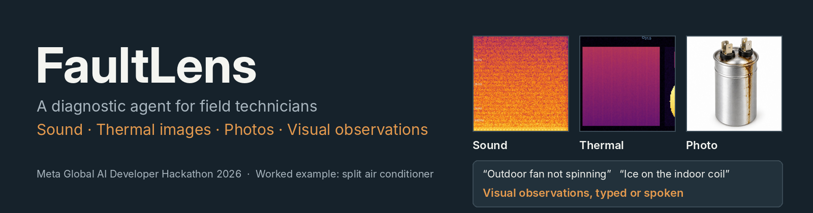

<p align="center"></p>

# FaultLens

**A repair assistant for field technicians, built on Gemini and Google Cloud.**

A technician on site has to decide what is wrong from what they can see, hear and measure, usually alone. FaultLens takes that evidence (the sound of the machine, thermal images, a sensor log, photos of parts, a spoken note, old handwritten job cards) and returns the likely cause, the evidence for and against it, and the next check to make. Fixed safety rules sit between the model and the technician.

**Worked example:** the split air conditioner, with 6 common faults and 18 parts. The method is not specific to air conditioners. A new kind of equipment needs its own fault guide, reference photos and signal patterns, with no change to the code.

Built by Mrinal Desai for **Startup Buildathon India 2026** (Google DeepMind and Google Cloud). FaultLens started as an earlier prototype on another model provider; this repository is the Google build, in which every model call goes to Gemini and the app runs on Cloud Run.

---

## Design principle

> Rules own safety, the pattern model owns the signals, Gemini owns the reasoning, and a second Gemini model owns the check.

Each job goes to the tool that does it best. A small trained pattern model reads the sound, thermal images and sensor log in milliseconds. Gemini weighs everything together and explains it. Fixed code, not a model, decides what is safe to do next. A different, larger Gemini model then reviews the diagnosis.

## How a diagnosis works

```
 sound · thermal · readings ──► pattern model ─────────┐
 photos of parts ────────────► Gemini Flash (boxes) ───┤
 spoken note ────────────────► Gemini Transcribe ──────┼──► Gemini Flash ──► safety rules ──► second check ──► cause + next check
 old job card ───────────────► Gemini Flash-Lite ──────┘    (reasons,        (fixed code)     (Gemini 4)
                                                             calls tools)
```

1. **Read the evidence.** Gemini finds the parts in each photo, turns the spoken note into text, and reads handwritten job cards into fields.
2. **Match patterns.** FaultLens's own model (gradient-boosted trees, one per signal, combined) scores every fault from the sound, thermal images and sensor log.
3. **Reason.** Gemini looks at the images itself, reads the pattern match, notes and history, calls tools to look up fault guides, and ranks the causes with evidence for and against each.
4. **Gate for safety.** Any next step that opens the unit or handles refrigerant is checked by fixed rules: isolate the power first, certified technicians only.
5. **Check.** A second Gemini model reviews the diagnosis against the same evidence and agrees or disagrees.

## How it uses Google AI

| Job | Model | Setting | Why this model |
|---|---|---|---|
| Reasoning with tool calls, step-by-step coaching, checking a part from a photo, finding parts in photos | `gemini-3.8-flash` | `AGENT_MODEL` | Reads pictures and text together and calls tools |
| Independent second check of each diagnosis | `gemini-4-argon` | `SECOND_CHECK_MODEL` | A different, larger model, so the check does not repeat the first answer's mistakes |
| Reading handwritten job cards | `gemini-3.5-flash-lite` | `CARD_MODEL` | A small, fast model is enough |
| Spoken notes to text | `gemini-3.5-transcribe` | `VOICE_MODEL` | Google's speech-to-text model |

All four are called through Google's `google-genai` library from one file, [`faultlens/gemini_client.py`](faultlens/gemini_client.py). If a model is not available to an account, that job falls back to `AGENT_MODEL` and the screen shows the model that really answered.

Gemini features used: pictures and audio as input, tool calling over several turns, thinking level, JSON output, and bounding boxes for parts.

## How it runs on Google Cloud

| Service | Used for |
|---|---|
| Cloud Run | Runs the app (one container, FastAPI) |
| Cloud Build and Artifact Registry | Build and store the container image from the `Dockerfile` |
| Secret Manager | Holds the Gemini API key; it is never in the image or the repo |
| Vertex AI (optional) | Gemini through the project's own service account, with no key (`AUTH=vertex`) |

Deploy with one command from the project folder:

```
PROJECT_ID=your-project-id ./deploy_gcp.sh
```

Or through Vertex AI, with no API key:

```
PROJECT_ID=your-project-id AUTH=vertex ./deploy_gcp.sh
```

The script turns on the services, stores the key, builds the image, deploys, and prints the live link. One instance is kept, because jobs in progress and the per-visitor limits are held in memory.

## Run it locally

```
python -m venv .venv
source .venv/bin/activate
pip install -r requirements.txt
cp .env.example .env
```

Put your Gemini API key in `.env`, then:

```
python -m faultlens.pattern
python check_gemini.py
python web/server.py
```

`faultlens.pattern` trains the pattern model (two to three minutes). `check_gemini.py` makes a few small calls to confirm the sign-in and each model work. The app opens at http://127.0.0.1:8000.

To work on the page with no model calls, set `FAULTLENS_MOCK=1` in `.env`.

## What is in the app

- **Play a job.** A simulated service call with a hidden fault. Pick checks, read findings, and ask the coach what to do next.
- **Investigate.** Give photos, a sound, thermal images, a sensor log and a note, and get a ranked diagnosis with a second check.
- **Check a part.** Photograph a part; it is compared with healthy and damaged reference photos.
- **Job cards.** Handwritten cards are read into fields, so a unit's history is not lost.
- **Anomaly lab.** Inject a fault into a healthy signal and watch the sliding-window detector find it.
- **How it was tested.** The saved results.

## Data and results: what is real and what is not

- The sound, thermal and sensor signals are **simulated** (`faultlens/simulate.py`). They are not field recordings.
- Reference photos are a mix of real photos and generated images; each is labelled with its source in the app.
- The pattern model was trained on 1,400 simulated units. Its report is in `models/pattern_report.json`.
- The saved investigation, part-check and image-reading results in `models/` were measured on the earlier prototype, with a different model provider. They are labelled that way in the app and **have not yet been re-run on Gemini**.

## Project layout

```
web/server.py              Web server (FastAPI): page + JSON API
web/index.html             The page: play a job, explore faults, job cards, investigate, how it was tested
Dockerfile                 Container image for Cloud Run
deploy_gcp.sh              One-command deploy to Cloud Run
check_gemini.py            Quick check of the Gemini sign-in and each model
faultlens/
  gemini_client.py         Every Gemini call goes through this file
  agent.py                 The tool-using investigation agent
  coach.py                 Step-by-step coach for a live job
  checker.py               Independent second check
  partcheck.py             Check a part from a photo against reference photos
  cardreader.py            Reads a handwritten job card into fields
  sam.py, voice.py         Finding parts in photos; spoken notes to text
  safety.py                Fixed safety rules applied after the model
  pipeline.py              One full round: parts, patterns, agent, safety, check
  pattern.py, features.py  FaultLens's own pattern model and its measurements
  simulate.py, sensors.py  Simulated signals and sensor logs
  game.py                  The service-job simulator
  anomaly.py, alarms.py, wear.py, parts.py, jobcards.py, library.py, render.py
  knowledge/split_ac.yaml  Faults, checks, normal ranges, safety rules
library/                   Reference library, one folder per condition
models/                    Saved reports (the pattern model itself is rebuilt on build)
eval/                      Test set and runners
```
